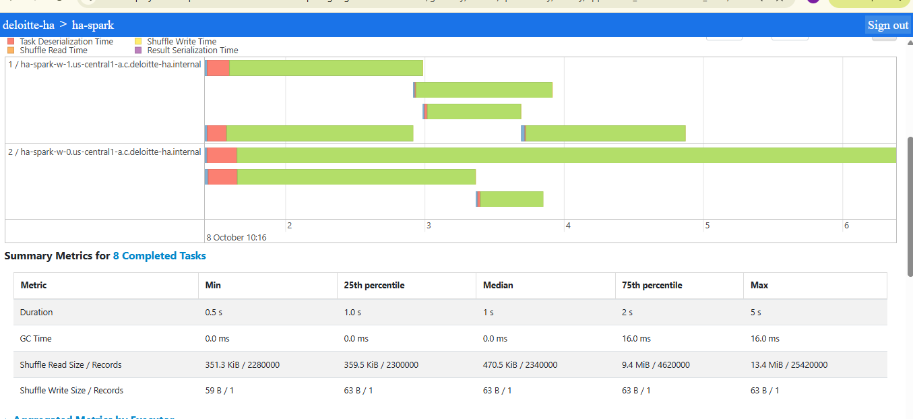
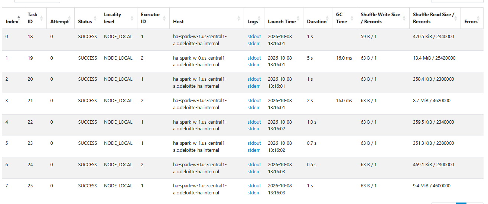

# Deloitte Data Engineering Home Assignment

Users and addresses pipeline on GCP: **local CSV → Cloud Storage → BigQuery (bronze) → Dataform (silver upsert, gold join) → Dataproc (users per city + skew demo)**.

The original requirements are in `[HOME_ASSIGNMENT.md](HOME_ASSIGNMENT.md)`.

## Architecture

```
data/*.csv ──upload_to_gcs.py──► gs://deloitte-ha-raw-data/raw/{table}/ingestion_date=YYYY-MM-DD/{table}_YYYYMMDDTHHMMSS.csv
                                        │
                                  load_to_bq.py  (append + load manifest)
                                        ▼
                     bronze.users / bronze.addresses        every batch, append-only
                                        │
                                Dataform incremental (MERGE)
                                        ▼
                     silver.users / silver.addresses        current state, one row per id
                                        │
                                Dataform table (LEFT JOIN)
                                        ▼
                               gold.users_details           user + address
                                        │
                              Dataproc / PySpark job
                                        ▼
                     users per city  +  skewed shuffle shown in the Spark UI
```


| Component            | Value                                                                           |
| -------------------- | ------------------------------------------------------------------------------- |
| GCP project / region | `deloitte-ha` / `us-central1`                                                   |
| Bucket               | `gs://deloitte-ha-raw-data`                                                     |
| BigQuery datasets    | `bronze`, `silver`, `gold`, `management` (load manifest), `dataform_assertions` |
| Dataform repository  | `deloitte-ha`, connected to this GitHub repo (branch `main`)                    |
| Dataproc cluster     | `ha-spark` (1 master + 2 workers, `e2-standard-4`)                              |


## Repository layout

```
data/                     users.csv, addresses.csv (the latest batch)
scripts/
  generate_batch.py       creates a new batch from the current silver state
  upload_to_gcs.py        uploads the CSVs to GCS as a new, timestamped batch
  load_to_bq.py           loads new GCS files into the bronze tables
  run_dataform.py         compiles Dataform from main and runs all actions
  run_pipeline.py         runs the four scripts above in order
definitions/              Dataform models
  sources/                declarations of bronze.users and bronze.addresses
  silver/                 users.sqlx, addresses.sqlx (incremental upsert)
  gold/                   users_details.sqlx (join)
workflow_settings.yaml    Dataform project settings
dataproc/
  users_per_city.py       PySpark job: users per city + skew demo
docs/spark_ui/            Spark UI screenshots (skew evidence)
```


## What was done, step by step


### 1–3. Data (users and addresses, one city with half the users)

The first batch has 2,000 users and 2,000 addresses (one address per user, `address_id = user_id`) across 11 Israeli cities. **Tel Aviv has exactly 50% of the users**, and the other 10 cities share the rest evenly.

Later batches contain only changes: status updates, address moves to another city, new users with addresses, and deliberately stale rows (an older `updated_at`) to test that the upsert ignores them. `scripts/generate_batch.py` creates such a batch from the current silver state and keeps Tel Aviv at 50%.

### 4. Git and Dataform repositories

The Dataform repository `deloitte-ha` is connected to this GitHub repo through Developer Connect. Dataform reads `workflow_settings.yaml` and `definitions/` from the repo root and ignores the other folders.

Development cycle: change the models locally, push to `main`, pull into the Dataform workspace to test, then run from `main`, as `run_dataform.py` does.

### 5. Upload to Cloud Storage (`upload_to_gcs.py`)

Each run uploads both CSVs as **new, immutable objects**:

```
raw/users/ingestion_date=2026-10-09/users_20261009T095830.csv
```

- The `ingestion_date=` folder lets the loader scan one day only.
- The timestamp in the file name means a batch never overwrites an earlier one, so the bucket keeps the full history.
- The bucket is private, with access controlled only through IAM (uniform bucket-level access) and public access blocked.


### 6. Load into BigQuery (`load_to_bq.py`)

- Scans **today's** `ingestion_date=` folder; `--date` loads another day.
- **Idempotent:** every loaded file is recorded in `management.load_manifest`, and files already listed there are skipped, so reruns don't create duplicates. The manifest row is written only after a successful load, so a failed file is retried on the next run.
- Each CSV is loaded into a temporary table, then inserted into bronze with `ingestion_time` set to the load time. The temporary table is always deleted.
- Bronze tables are **append-only** and partitioned by day on `ingestion_time`. They keep every version of every row.


### 7. Dataform incremental upsert (`definitions/silver/*.sqlx`)

`silver.users` and `silver.addresses` are `incremental` tables with a `uniqueKey`, so Dataform generates a `MERGE`: matching ids are updated and new ids are inserted.

1. **Watermark:** each run reads only bronze rows with `ingestion_time` later than the latest one already in silver.
2. **Deduplication:** if a run covers several batches, `QUALIFY ROW_NUMBER()` keeps only the latest version of each id.
3. **Stale-row guard:** a row whose `updated_at` is older than the version already in silver is dropped, so a late or replayed batch can't overwrite newer data.

Assertions check that the key is unique and that `user_id` and `updated_at` are never NULL.

> Trade-off: the stale-row guard joins the target table, which is a second scan on top of the MERGE's own. At scale, a hand-written `MERGE` with `WHEN MATCHED AND s.updated_at > t.updated_at` would avoid it. The code comments explain this.


### 8. Dataform join (`definitions/gold/users_details.sqlx`)

`gold.users_details` is `silver.users LEFT JOIN silver.addresses`, so users without an address are kept. It holds the user's contact details and status, the address (city, state, country) and `last_updated_at`, the later of the two `updated_at` values. It is rebuilt in full on each run, which is cheap at this size and always consistent. Assertions check that `(user_id, address_id)` is unique.

Dataform runs actions in dependency order (bronze → silver → gold) based on the `ref()` calls, so no ordering is configured by hand.

### 9. Dataproc: users per city (`dataproc/users_per_city.py`)

The job reads `gold.users_details` through the BigQuery connector and prints the number of users per city:

```
+-------------+-----+
|         city|count|
+-------------+-----+
|     Tel Aviv| 1155|
|    Beersheba|  117|
|        Holon|  117|
|          ...|  ...|
```


### 10–11. Skew in the Spark UI, and the disabled optimizations

**Why a plain** `groupBy("city").count()` **doesn't show skew.** Spark adds up the counts for each city inside each task *before* the shuffle (partial aggregation). Only about one row per city per task is shuffled, so Tel Aviv's share disappears. This can't be turned off.

**The demo.** To make the skew visible, the job:

1. Copies every user row 20,000 times, keeping the 50% Tel Aviv mix, for about 46 million rows. The copies are generated inside Spark (`spark.range` cross join with the broadcast users table).
2. Shuffles every row by city with `repartition(8, "city")`. All Tel Aviv rows hash to the same partition, so one task receives about half the data.

**The optimizations disabled (step 11):**


| Setting                                     | Why                                                                                                                                                     |
| ------------------------------------------- | ------------------------------------------------------------------------------------------------------------------------------------------------------- |
| `spark.sql.adaptive.enabled = false`        | Adaptive query execution would detect the oversized partition at runtime and split it (skew-join handling), or merge small partitions, hiding the skew. |
| `spark.sql.autoBroadcastJoinThreshold = -1` | Stops Spark from choosing broadcast joins on its own, so the plan stays as written.                                                                     |
| `spark.sql.shuffle.partitions = 8`          | A fixed number of partitions, equal to the 8 worker cores, so every partition is one task and all tasks run at the same time.                           |


**Evidence.** Spark History Server → Job 2 → the stage that reads the `repartition` shuffle:



- **Summary metrics:** the median task read 2,340,000 records, while the max read **25,420,000**, about 11 times more. Median duration was 1 s and max **5 s**.
- **Event timeline:** one long green bar, the Tel Aviv task, keeps running after the others have finished, so the stage takes as long as that single task while most cores sit idle.



- **Tasks table:** task 1 reads 25.4 M records (13.4 MiB), because it holds Tel Aviv plus one small city. Tasks with one small city read about 2.3 M records, and tasks 3 and 7 read about 4.6 M because two small cities hash to the same partition.


## How to run


### Prerequisites

- Python 3.10+ and the [gcloud CLI](https://cloud.google.com/sdk/docs/install).
- Access to the `deloitte-ha` project. Your account needs to read and write GCS and BigQuery, and to start Dataform runs as the `dataform-runner` service account.

```powershell
pip install -r requirements.txt
gcloud auth application-default login
gcloud auth application-default set-quota-project deloitte-ha
```


### Run the whole pipeline (steps 1 and 5–8)

From the repo root:

```powershell
python scripts/run_pipeline.py
```

It runs, and stops at the first failure:

1. `generate_batch.py`: writes a new batch to `data/users.csv` and `data/addresses.csv`. **This overwrites the current CSVs.**
2. `upload_to_gcs.py`: uploads the batch to the bucket.
3. `load_to_bq.py`: loads the new files into bronze.
4. `run_dataform.py`: compiles the code on `main` and runs all actions as `dataform-runner`, then prints each action's result. Dataform runs the code on GitHub, so push model changes first. Runs appear in the Dataform repository under **Workflow execution logs**.

Each step can also be run on its own, for example `python scripts/load_to_bq.py --date 2026-10-09`.

### Run the Dataproc job (steps 9–11)

Run these commands in Cloud Shell, each on one line. Upload `dataproc/users_per_city.py` to Cloud Shell first, or clone this repo there.

One-time setup. The cluster machines have internal IPs only, so the subnet needs Private Google Access to reach BigQuery:

```bash
gcloud config set project deloitte-ha
gcloud services enable dataproc.googleapis.com
gcloud compute networks subnets update default --region=us-central1 --enable-private-ip-google-access
```

Create the cluster. `--enable-component-gateway` makes the Spark UI available in the console, and the cluster deletes itself after 2 idle hours:

```bash
gcloud dataproc clusters create ha-spark --region=us-central1 --image-version=2.2-debian12 --master-machine-type=e2-standard-4 --master-boot-disk-size=50GB --num-workers=2 --worker-machine-type=e2-standard-4 --worker-boot-disk-size=50GB --enable-component-gateway --max-idle=2h
```

Submit the job:

```bash
gcloud dataproc jobs submit pyspark users_per_city.py --cluster=ha-spark --region=us-central1
```

View the Spark UI: **Dataproc → Clusters → ha-spark → Web Interfaces → Spark History Server** → the `users-per-city-skew` application → **Jobs → Job 2** → the middle stage, which reads the shuffle.

Stop the cluster (only disks are billed) or delete it:

```bash
gcloud dataproc clusters stop ha-spark --region=us-central1
gcloud dataproc clusters delete ha-spark --region=us-central1 --quiet
```
